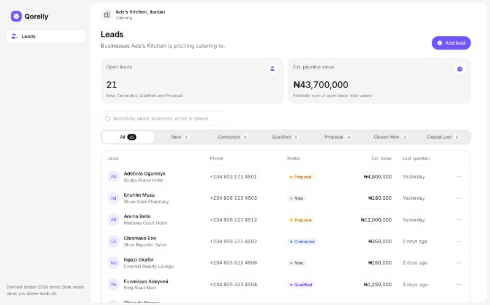
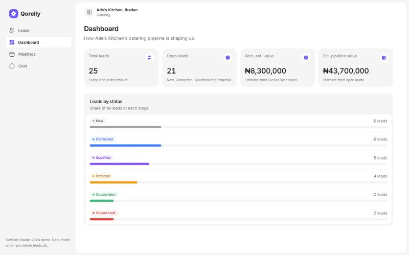
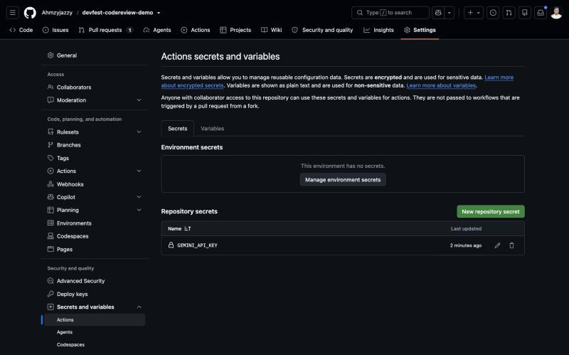
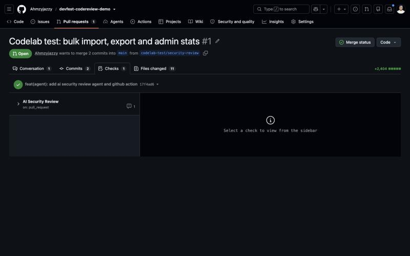
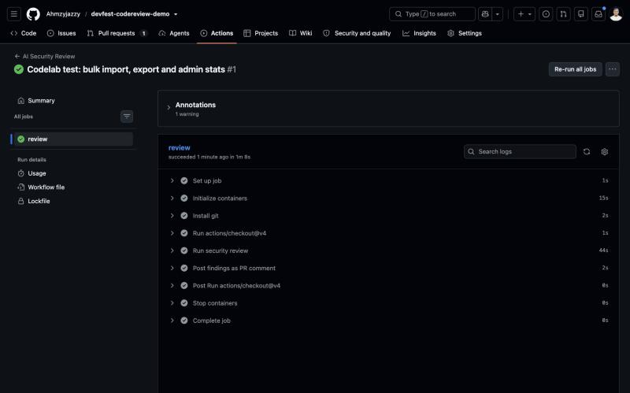

# Review AI-written code with the Antigravity CLI and SDK

**DevFest Ibadan 2026 workshop · about 90 minutes**

This workshop is adapted from Google's codelab [Supercharge Code Quality: AI-Assisted Code Review with Antigravity CLI and SDK](https://codelabs.developers.google.com/agy-cli-sdk-code-review) and its sample app [alphinside/leads-crm-app-demo](https://github.com/alphinside/leads-crm-app-demo). The original codelab text is licensed under [CC BY 4.0](https://creativecommons.org/licenses/by/4.0/) and its code samples under Apache 2.0. This version runs on your own laptop, uses a Qorelly-styled app, and is set in Ibadan.

## 0. Overview

**Ade’s Kitchen** is a catering business in Ibadan. It tracks the businesses it pitches to (hotels, salons, pharmacies, shops) in a small leads app. A teammate used an AI coding agent to add two features quickly: lead search and bulk import/export. Both shipped without a security review.

In this workshop you will:

1. Run the app on your laptop.
2. **Case 1:** review the lead search feature with the **Antigravity CLI**, fix what it finds, and prove the fix works.
3. **Case 2:** build a **review agent with the Antigravity SDK**, run it locally, then run it automatically on every pull request with **GitHub Actions**.
4. **Bonus:** see how project rules and skills help an agent catch a leaked API key.

| Section | Time |
|---|---|
| 1. Before you start | 10 min |
| 2. Fork and run the app | 10 min |
| 3. The problem | 5 min |
| 4. Case 1: review with the CLI | 25 min |
| 5. Case 2, part 1: build the review agent | 20 min |
| 6. Case 2, part 2: add the GitHub Action | 5 min |
| 7. Case 2, part 3: test it on a pull request | 10 min |
| 8. Bonus: rules and skills catch a leaked key | 10 min |

Stuck at any point? Every finished step exists on a branch. Compare your work with `feature/bulk-operations-solution`.

## 1. Before you start

### Accounts

- A **GitHub** account.
- A **Gemini API key** from [Google AI Studio](https://aistudio.google.com/apikey). The free tier is enough. Treat the key like a password: never paste it into a file you commit, into chat, or into a screenshot.

### Tools

You need Git, Node.js 20 (through nvm), the GitHub CLI, uv and the Antigravity CLI.

**Windows:** use [WSL2](https://learn.microsoft.com/windows/wsl/install) with Ubuntu and run every command below inside it. The app uses a native SQLite module and bash commands.

**macOS** (with [Homebrew](https://brew.sh)):

```bash
brew install git gh uv nvm
```

**Ubuntu / WSL2:**

```bash
sudo apt update && sudo apt install -y git build-essential python3 curl
```

```bash
curl -LsSf https://astral.sh/uv/install.sh | sh
```

Install the GitHub CLI by following [cli.github.com](https://github.com/cli/cli/blob/trunk/docs/install_linux.md), and nvm by following [github.com/nvm-sh/nvm](https://github.com/nvm-sh/nvm#installing-and-updating).

**Node.js 20** (all systems, after nvm is installed; open a new terminal first):

```bash
nvm install 20
```

**Antigravity CLI** (macOS, Linux and WSL2):

```bash
curl -fsSL https://antigravity.google/cli/install.sh | bash
```

The installer puts `agy` in `~/.local/bin`. Open a new terminal so it is on your `PATH`.

### Sign in

Sign in to GitHub:

```bash
gh auth login
```

Choose **GitHub.com**, **HTTPS**, and **Login with a web browser**, then enter the one-time code it shows.

Start the Antigravity CLI once to sign in:

```bash
agy
```

Choose **Google OAuth** (or your Gemini API key), finish the sign-in in the browser, pick a theme, accept the terms, then press `Ctrl+D` twice to exit.

### Check your setup

```bash
git --version
```

```bash
node -v
```

```bash
gh --version
```

```bash
uv --version
```

```bash
agy --version
```

You should see a version for each command. Node must start with `v20`. This guide was tested with Node 20.15, uv 0.6, gh 2.96 and agy 1.5.

## 2. Fork and run the app

### Fork with all branches

The exercises live on feature branches, so your fork needs every branch, not just `main`.

```bash
gh repo fork Ahmzyjazzy/devfest-codereview-demo --clone
```

```bash
cd devfest-codereview-demo
```

Point `gh` at **your fork**, so pull requests and secrets go there and not to the workshop repo. Replace `<your-username>` with your GitHub username:

```bash
gh repo set-default <your-username>/devfest-codereview-demo
```

Check that all four feature branches came with the fork:

```bash
git branch -a | grep feature/
```

You should see:

```
  remotes/origin/feature/bulk-operations
  remotes/origin/feature/bulk-operations-solution
  remotes/origin/feature/email-composer
  remotes/origin/feature/lead-search
```

Prefer the website? Open [the repo](https://github.com/Ahmzyjazzy/devfest-codereview-demo), click **Fork**, and **untick "Copy the main branch only"**. Then clone your fork and run the `gh repo set-default` command above.

### Run the app

```bash
nvm use
```

```bash
npm install
```

```bash
npm run dev
```

Open http://localhost:3000. The first run creates `leads.db` with 25 sample leads, 10 meetings and 15 notes.

Take a quick tour:

- **Leads:** search, status tabs, add a lead, open one to see its notes and meetings.
- **Dashboard:** open leads and the estimated pipeline. Every ₦ figure is an estimated deal size, not revenue.
- **Meetings:** every meeting across all leads.
- **Chat:** an assistant that answers questions about your leads. It is optional (see below).





**Optional: turn on Chat.** Chat calls Gemini from the server, so your key never reaches the browser.

```bash
cp .env.example .env
```

Open `.env` in your editor, put your key after `GEMINI_API_KEY=`, save, and restart `npm run dev`. `.env` is in `.gitignore`, so it is never committed.

Stop the server with `Ctrl+C` before the next section.

## 3. The problem

Your teammate's two features are on these branches:

- `feature/lead-search`: a search endpoint for leads.
- `feature/bulk-operations`: bulk import, CSV export and admin stats.

Look at what each one changes:

```bash
git diff --stat main...origin/feature/lead-search
```

```bash
git diff main...origin/feature/lead-search
```

```bash
git diff --stat main...origin/feature/bulk-operations
```

The code works, and the app still runs. Before you read it closely, ask yourself: would you approve this pull request? In the next two sections, an agent reviews it for you.

## 4. Case 1: review with the Antigravity CLI

### Check out the branch

```bash
git checkout feature/lead-search
```

### Add review skills

A **skill** is a Markdown playbook the agent loads when it is relevant: a checklist and a way of working. Skills in `.agents/skills/` apply to this project only. You will add two community skills from [addyosmani/agent-skills](https://github.com/addyosmani/agent-skills):

- `code-review-and-quality`: reviews a change on five axes and labels each finding by severity.
- `security-and-hardening`: checks input handling, secrets, authentication and logging.

```bash
npx skills@1.5.18 add addyosmani/agent-skills --skill code-review-and-quality -y
```

```bash
npx skills@1.5.18 add addyosmani/agent-skills --skill security-and-hardening -y
```

We pin `skills@1.5.18` because newer releases of the installer need Node 22.20 or later, and this app uses Node 20.

You should see both skills under `.agents/skills/`:

```bash
ls .agents/skills
```

You should see:

```
code-review-and-quality
security-and-hardening
```

The installer may also create a `skills-lock.json` file and copies for other AI tools it finds on your laptop (for example `.claude/skills`). You do not need to commit any of these.

### Start the CLI

```bash
agy --dangerously-skip-permissions
```

> **Warning:** `--dangerously-skip-permissions` lets the agent run commands and edit files without asking you. Use it only in a throwaway fork like this one, never on real projects.

Type `/skills` and press Enter. Both skills should be listed under **Workspace**. Press `Esc` to close the list.

### Ask for a review

Paste this prompt:

```
Review the git diff between main and my current branch.
Find any issues based on the agent skills that are appropriate for this.
Write the findings and plan to fix them to code_review.md in the current working directory.
Do not apply fixes yet.
```

When it finishes, open `code_review.md` in your editor and read it. For each finding, check the file and line it points to.

**What the reviewer should find** (categories, not answers):

- SQL built directly from user input.
- Logging that records raw queries and search terms.
- Internal error details sent back to the caller.
- Missing input validation.

If your review missed one of these, ask the agent about it in plain words, for example: "Can user input change the SQL in the search endpoint?"

### Apply the fixes

```
Apply the proposed fixes from code_review.md
```

Read the diff the agent made before you trust it:

```bash
git diff
```

Exit the CLI with `Ctrl+D` twice.

### Prove the fix

Start the app:

```bash
npm run dev
```

In a second terminal, a normal search should still work:

```bash
curl -s "localhost:3000/api/leads/search?q=pharmacy" | python3 -c "import json,sys;print(len(json.load(sys.stdin)),'results')"
```

You should see:

```
5 results
```

Now try the classic injection. Before the fix it returned all 25 leads:

```bash
curl -s "localhost:3000/api/leads/search?q=%27%20OR%201%3D1%20--" | python3 -c "import json,sys;print(len(json.load(sys.stdin)),'results')"
```

You should see `0 results`. Stop the server with `Ctrl+C`.

### Commit only what you changed

`code_review.md` is in `.gitignore`, so it is never committed. Check what changed, then commit only the code fix:

```bash
git status
```

```bash
git add server.ts
```

```bash
git commit -m "fix(server): make lead search safe from sql injection"
```

Avoid `git add .` in this workshop: it picks up files you did not mean to share.

This repo checks every commit message with commitlint. A message needs a type and a scope, like `fix(server): …` or `feat(agent): …`. The allowed scopes are `repo`, `ui`, `server`, `db`, `docs`, `agent` and `ci`. A message without a scope is rejected with `scope may not be empty`.

## 5. Case 2, part 1: build a review agent with the SDK

Reviewing in the CLI works when you remember to do it. A review agent in CI runs on **every** pull request. The **Antigravity SDK** (`google-antigravity`) is a Python library with the same agent runtime as the CLI, so you can run it anywhere, including GitHub Actions.

### Check out the bulk operations branch

```bash
git checkout feature/bulk-operations
```

### Create the project

```bash
uv init code_review_agent
```

```bash
uv add --project code_review_agent google-antigravity==0.1.7
```

### Give the agent its skills

The agent needs its own copy of the two skills, inside its folder, so it can find them in CI. Check you still have them from section 4:

```bash
ls .agents/skills
```

If you see `No such file or directory`, install them again:

```bash
npx skills@1.5.18 add addyosmani/agent-skills --skill code-review-and-quality -y
```

```bash
npx skills@1.5.18 add addyosmani/agent-skills --skill security-and-hardening -y
```

Then copy them into the agent's folder:

```bash
cp -r .agents/skills code_review_agent/skills
```

### Write the agent

Create `code_review_agent/review_agent.py` with this content:

```python
#!/usr/bin/env python3
import asyncio
import json
import os
import sys

import pydantic

from google.antigravity import Agent, LocalAgentConfig, CapabilitiesConfig
from google.antigravity.hooks import hooks, policy
from google.antigravity import types


class Finding(pydantic.BaseModel):
    file: str
    line: int
    severity: str
    category: str
    description: str
    proposed_fix: str = ""


class ReviewResult(pydantic.BaseModel):
    findings: list[Finding]


SCRIPT_DIR = os.path.dirname(os.path.abspath(__file__))
OUTPUT_FILE = "code_review.md"
SKILLS_PATHS = [
    os.path.join(SCRIPT_DIR, "skills", "security-and-hardening"),
    os.path.join(SCRIPT_DIR, "skills", "code-review-and-quality"),
]

review_policies = [
    policy.deny("*"),
    policy.allow("view_file"),
    policy.allow("list_directory"),
    policy.allow("search_directory"),
    policy.allow("find_file"),
    policy.allow("run_command"),
    policy.allow("finish"),
]

@hooks.post_tool_call
async def log_tool_results(data: types.ToolResult):
    result_str = str(data.result) if data.result else ""
    preview = result_str[:200] + "..." if len(result_str) > 200 else result_str
    print(f"[audit] tool={data.name} result_len={len(result_str)} error={data.error} preview={preview}", flush=True)

@hooks.pre_tool_call_decide
async def enforce_safe_tools(data: types.ToolCall) -> types.HookResult:
    print(f"[audit] calling tool={data.name} args_keys={list(data.args.keys())}", flush=True)

    if data.name == "run_command":
        cmd = str(data.args.get("CommandLine", ""))
        if not cmd.startswith("git "):
            return types.HookResult(
                allow=False,
                message=f"Only git commands are allowed. Blocked: {cmd}"
            )
    return types.HookResult(allow=True)

async def review_code(target_dir: str) -> dict:
    prompt = f"""Run `git diff main...HEAD` in {target_dir} to get the changes on this branch.
Review ONLY the changed code for security issues.
"""

    config_kwargs = dict(
        system_instructions=(
            "You are a security-focused code review agent. "
            "You review code diffs for vulnerabilities using the loaded skills. "
            "You can run git commands to inspect the diff. "
            "You NEVER modify files."
        ),
        response_schema=ReviewResult,
        skills_paths=SKILLS_PATHS,
        policies=review_policies,
        hooks=[log_tool_results, enforce_safe_tools],
    )

    if os.environ.get("GEMINI_API_KEY"):
        config_kwargs["api_key"] = os.environ["GEMINI_API_KEY"]
    else:
        config_kwargs["vertex"] = True
        config_kwargs["project"] = os.environ.get("GOOGLE_CLOUD_PROJECT")
        config_kwargs["location"] = os.environ.get("GOOGLE_CLOUD_LOCATION", "global")

    config = LocalAgentConfig(**config_kwargs)

    async with Agent(config) as agent:
        response = await agent.chat(prompt)

        last_step = -1
        final_text_chunks = []
        async for chunk in response.chunks:
            if isinstance(chunk, types.ToolCall):
                final_text_chunks.clear()
            if hasattr(chunk, "text") and hasattr(chunk, "step_index"):
                if chunk.step_index != last_step:
                    final_text_chunks.clear()
                    last_step = chunk.step_index
                final_text_chunks.append(chunk.text)

        final_text = "".join(final_text_chunks)
        if final_text:
            print(final_text)

        data = await response.structured_output()

        if data and "findings" in data:
            return {"findings": data["findings"]}

        try:
            parsed = json.loads(final_text)
            if isinstance(parsed, list):
                return {"findings": parsed}
            if isinstance(parsed, dict) and "findings" in parsed:
                return {"findings": parsed["findings"]}
        except json.JSONDecodeError:
            pass

    return {"findings": final_text}


SEVERITY_EMOJI = {"critical": "🔴", "high": "🟠", "medium": "🟡", "low": "🔵"}

def format_markdown(result: dict) -> str:
    findings = result.get("findings", [])
    if isinstance(findings, str):
        return f"## AI Security Review\n\n{findings}\n"
    if not findings:
        return "## AI Security Review\n\nNo security issues found.\n"
    lines = ["## AI Security Review\n"]
    for f in findings:
        emoji = SEVERITY_EMOJI.get(f.get("severity", ""), "⚪")
        lines.append(f"### {emoji} [{f.get('severity', 'unknown').upper()}] {f.get('category', '')}\n")
        lines.append(f"**{f.get('file', '')}:{f.get('line', '')}**\n")
        lines.append(f"{f.get('description', '')}\n")
        proposed_fix = f.get('proposed_fix', '')
        if proposed_fix:
            lines.append(f"**Proposed fix:** {proposed_fix}\n")
    lines.append("---\n*Powered by Antigravity SDK*")
    return "\n".join(lines)


if __name__ == "__main__":
    target = sys.argv[1] if len(sys.argv) > 1 else "."
    result = asyncio.run(review_code(target))
    markdown = format_markdown(result)
    with open(OUTPUT_FILE, "w") as f:
        f.write(markdown)
    print(f"Review written to {OUTPUT_FILE}")
    print(json.dumps(result, indent=2))
```

What the important parts do:

- **Policies** start from "deny everything", then allow only tools that read files plus `run_command` and `finish`. The agent cannot edit or delete files.
- **The `enforce_safe_tools` hook** runs before every tool call. It blocks any command that does not start with `git `, so `run_command` can only inspect the repo.
- **The `log_tool_results` hook** prints a short audit line for every tool result, which you will see in CI logs.
- **`response_schema`** asks for structured findings (file, line, severity, category, description, proposed fix), which `format_markdown` turns into `code_review.md`.
- **Authentication** uses `GEMINI_API_KEY` if it is set; otherwise Vertex AI.

### Run it locally

Set your key in this terminal only (it is not saved anywhere):

```bash
export GEMINI_API_KEY=your-key-here
```

```bash
uv run --project code_review_agent code_review_agent/review_agent.py .
```

It takes a minute or two. You will see `[audit]` lines as the agent runs `git diff` and reads files, then `Review written to code_review.md` and the findings as JSON. Open `code_review.md`.

You should see headings like:

```
### ⚪ [SEVERITY] Category
**server.ts:<line>**
What is wrong.
**Proposed fix:** How to fix it.
```

The circle may be grey: the model sometimes writes the severity in capitals, which the script's colour map does not match. The findings are the same.

**What it should find** (categories, not answers):

- A hardcoded admin credential.
- A password sent in the URL.
- Admin endpoints that skip authentication.
- A file path built from user input.
- Personal data written to logs.
- Missing validation on bulk import.
- Unescaped CSV output.

## 6. Case 2, part 2: run the agent on every pull request

Create the workflow file:

```bash
mkdir -p .github/workflows
```

Create `.github/workflows/security_review.yml` with this content:

```yaml
name: AI Security Review

on:
  pull_request:
    types: [opened, synchronize]

jobs:
  review:
    runs-on: ubuntu-latest
    permissions:
      contents: read
      pull-requests: write

    container:
      image: ghcr.io/astral-sh/uv:python3.12-bookworm

    steps:
      - name: Install git
        run: apt-get update && apt-get install -y git
      - uses: actions/checkout@v4
        with:
          fetch-depth: 0
      - name: Run security review
        env:
          GEMINI_API_KEY: ${{ secrets.GEMINI_API_KEY }}
        run: |
          git config --global --add safe.directory $GITHUB_WORKSPACE
          uv run --project code_review_agent code_review_agent/review_agent.py .
      - name: Post findings as PR comment
        if: always()
        uses: actions/github-script@v7
        with:
          script: |
            const fs = require('fs');
            const body = fs.readFileSync('code_review.md', 'utf8');
            await github.rest.issues.createComment({
              owner: context.repo.owner,
              repo: context.repo.repo,
              issue_number: context.payload.pull_request.number,
              body: body
            });
```

The Google codelab names this file `code_review.yml`. This repo uses `security_review.yml` to match the solution branch; the name does not change how it works.

Commit the agent and the workflow, then push:

```bash
git add code_review_agent .github
```

```bash
git commit -m "feat(agent): add ai security review agent and github action"
```

```bash
git push origin feature/bulk-operations
```

## 7. Case 2, part 3: test it on a pull request

### Turn on Actions in your fork

GitHub switches off workflows in new forks. Open your fork on GitHub, click the **Actions** tab, and click **I understand my workflows, go ahead and enable them**.

### Add your key as a repository secret

```bash
gh secret set GEMINI_API_KEY
```

Paste your key when asked and press Enter. It is sent to GitHub encrypted and is never shown again. (Or use **Settings → Secrets and variables → Actions → New repository secret**.)

You should see `GEMINI_API_KEY` listed under **Repository secrets**. GitHub shows only the name, never the value.



### Open a pull request into your own fork

```bash
gh pr create --base main --head feature/bulk-operations --title "Bulk import, export and admin stats" --body "Workshop test of the AI security review."
```

Because you ran `gh repo set-default` earlier, this opens the PR in **your fork**. Check the URL it prints: it must contain your username, not `Ahmzyjazzy`.

### Watch the review

```bash
gh pr checks --watch
```

The check takes about a minute. When it passes, you should see a green tick next to **AI Security Review** on the PR's **Checks** tab:



Click the check to see each step. **Run security review** is the agent at work, and **Post findings as PR comment** adds its review to the PR:



Open the PR's **Conversation** tab. The findings appear as a comment from **github-actions**, with a severity, a file and line, and a proposed fix for each issue. Compare them with what the agent found locally in section 5: the wording changes from run to run, but the issues should be the same.

You may also see a warning that Node.js 20 is deprecated for `actions/checkout@v4` and `actions/github-script@v7`. It does not affect the review.

The workflow runs for pull requests inside your fork. It does not run for pull requests from other people's forks, because GitHub does not share secrets with them.

## 8. Bonus: rules and skills catch a leaked key

`feature/email-composer` adds an **Email** page that drafts sales emails with Gemini. It was also built by an agent, and this branch includes the project's agent **rules** (`.agents/rules/project-context.md`) and a **review protocol skill** (`.agents/skills/fullstack-testing-code-review-protocol/SKILL.md`).

```bash
git checkout feature/email-composer
```

Read the rules file, especially **Secret Management**:

```bash
cat .agents/rules/project-context.md
```

Start the CLI and ask for a review against the project's own rules:

```bash
agy --dangerously-skip-permissions
```

```
Review the git diff between main and my current branch against the rules in .agents/rules and the fullstack testing and code review protocol skill. Write the findings to code_review.md. Do not apply fixes.
```

Does the review notice where the Gemini key ends up? Check for yourself: build the app with a fake key and search the bundle the browser downloads.

```bash
GEMINI_API_KEY=test-key-not-real npm run build
```

```bash
grep -c test-key-not-real dist/assets/*.js
```

If the count is above 0, anyone who opens the page can read the key. Compare with `main`, where Chat calls Gemini from the server. Delete the build when you are done:

```bash
rm -rf dist
```

## 9. Wrap up

You reviewed AI-written code two ways:

- **Interactively** with the Antigravity CLI and community skills, then fixed and proved the fix.
- **Automatically** with an Antigravity SDK agent that can only read code and run `git`, posting findings on every pull request.

Clean up:

- Close your pull request **without merging**: the bulk operations code is still unsafe.

```bash
gh pr close feature/bulk-operations
```

- If you pasted your Gemini key anywhere you should not have, delete it in [Google AI Studio](https://aistudio.google.com/apikey) and create a new one.
- Optionally delete your fork: **Settings → Danger Zone → Delete this repository**.

Further reading:

- [Antigravity CLI and SDK docs](https://antigravity.google/docs/getting-started)
- [addyosmani/agent-skills](https://github.com/addyosmani/agent-skills)
- [The original Google codelab](https://codelabs.developers.google.com/agy-cli-sdk-code-review)

## 10. Troubleshooting

**Port 3000 is already in use.** Another copy of the app is running. Stop it with `Ctrl+C` in its terminal, or find it with `lsof -i :3000`.

**`node -v` is not v20.** Run `nvm use` inside the project folder. If nvm says it is not installed, run `nvm install 20`.

**`npm install` fails on `better-sqlite3`.** Install build tools: `xcode-select --install` on macOS, `sudo apt install -y build-essential python3` on Ubuntu/WSL2. Then delete `node_modules` and run `npm install` again.

**`agy: command not found`.** Open a new terminal, or add `~/.local/bin` to your `PATH`.

**`uv: command not found`.** Open a new terminal after installing uv, or run `source $HOME/.local/bin/env`.

**The review agent says it has no credentials.** Run `export GEMINI_API_KEY=...` in the same terminal you run `uv run` from.

**The GitHub Action fails at "Run security review".** Check that the `GEMINI_API_KEY` secret exists in **your fork** (`gh secret list`) and that Actions are enabled.

**The PR opened on `Ahmzyjazzy/devfest-codereview-demo`.** Close it, run `gh repo set-default <your-username>/devfest-codereview-demo`, and create it again.

**I want fresh sample data.** Stop the server, delete `leads.db`, and run `npm run dev`.
